# House Walkthrough

**Turn floor plans into a 3D house you can walk through in the browser.**
Each floor is described in a single JSON file (the *House JSON*). The app builds the walls, doors,
windows, floors, stairs, railings and roof from it, then lets you explore in first or third person,
climb the stairs between floors, and switch between an 8 AM morning and night.

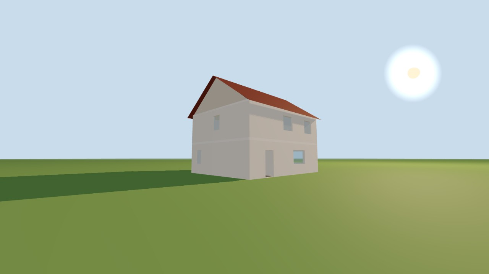

<p align="center">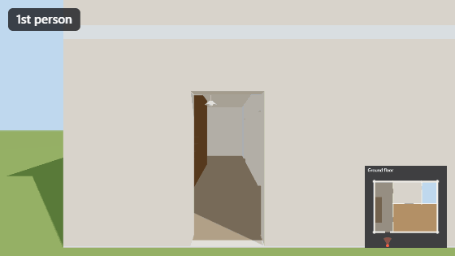</p>

> Built with Three.js, TypeScript and Vite. No backend: everything runs in the browser.

---

## Contents

- [Quick start](#quick-start)
- [Features](#features)
- [Controls](#controls)
- [Gallery](#gallery)
- [How it works](#how-it-works)
- [The House JSON](#the-house-json)
- [Project layout](#project-layout)
- [Testing](#testing)
- [Roadmap](#roadmap)
- [Known limitations](#known-limitations)

---

## Quick start

Requires **Node.js 20+** (developed on Node 26).

```bash
npm install
npm run dev
```

Open <http://localhost:5173>, click the card to start, and walk in through the front door.

| Script | What it does |
|---|---|
| `npm run dev` | Start the dev server with hot reload |
| `npm test` | Run the unit tests (schema validation, walking physics, camera maths) |
| `npm run typecheck` | TypeScript type-check only |
| `npm run build` | Type-check and build a static site into `dist/` |
| `npm run preview` | Serve the production build locally |

---

## Features

**Walking**
- First-person and third-person views, switch any time with **V**
- Wall and railing collision: you slide along walls and fit through doors and archways
- Real stair climbing: walk up and down the flight, and the floor you're on updates automatically
- You can't walk through the side of a stair or fall into the stairwell

**Seeing the house**
- Minimap of the current floor with your position and viewing direction
- Floor switcher: jump straight to any floor (keys **1–9**)
- Top-down overview (**Tab**): a cutaway of the selected floor that you can orbit and zoom
- Day / night (**N**):
  - **Day is 8 AM.** A visible sun sits low in the east-south-east sky, about 20° up. It is a point light that casts soft shadows, gives a warm morning colour, throws long shadows, and sends deep patches of sunlight through the windows.
  - **Night:** moonlight, plus a shadow-casting ceiling lamp in every room

**The model**
- One JSON file describes the whole house: walls, doors, arches, windows, rooms, slab holes, stairs, railings and roof
- Room type sets the floor finish (living, kitchen, bedroom, bathroom, …)
- Gable or flat roof, generated automatically from the top floor
- A validator checks the plan when it loads, for example whether every stair has a matching hole in the floor above

---

## Controls

| Motion | Keys |
|---|---|
| **Forward / backward** | `W` / `S` |
| **Left / right** | `A` / `D` step sideways · `←` / `→` turn · mouse |
| **Face up / face down** | `↑` / `↓` · mouse |
| Run | hold `Shift` |
| 1st / 3rd person | `V` (or the HUD button) |
| Day / night | `N` (or the HUD button) |
| Jump to floor | `1` – `9` (or the floor buttons) |
| Top-down overview | `Tab`, then drag to orbit and scroll to zoom |
| Release the mouse | `Esc` |

<p align="center">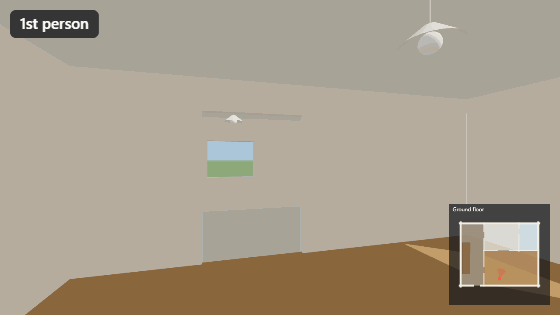</p>

In third person, a stand-in figure walks ahead of the camera. If a wall, ceiling or window comes
between the camera and the figure, the camera moves in closer, so it never ends up outside the room.

---

## Gallery

| | |
|---|---|
| 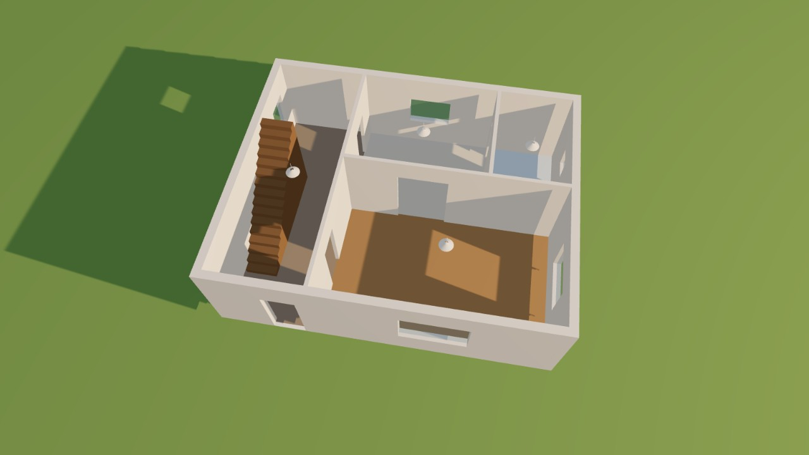 | 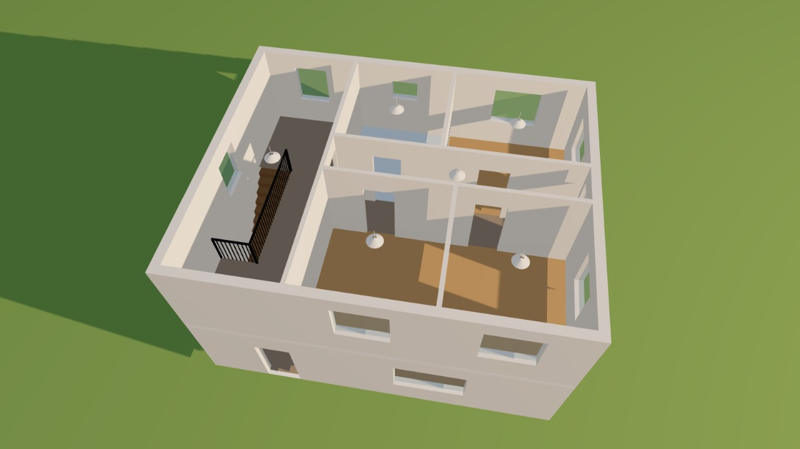 |
| **Overview, ground floor**: hall with stairs, living room, kitchen through an archway, WC | **Overview, first floor**: landing with railed stairwell, corridor, three bedrooms, bathroom |
| 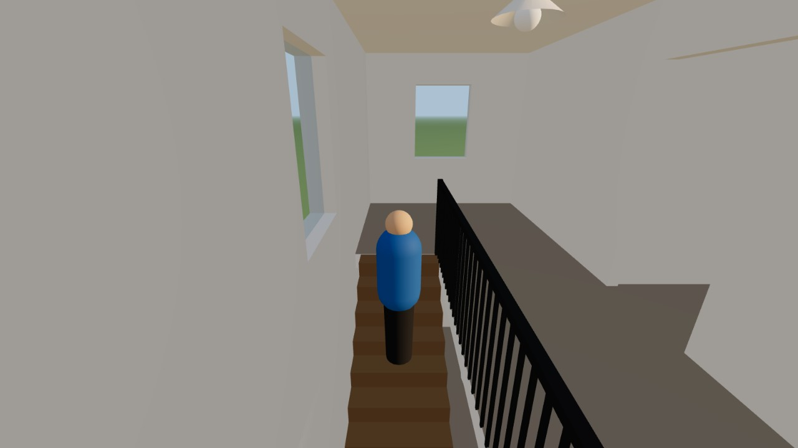 | 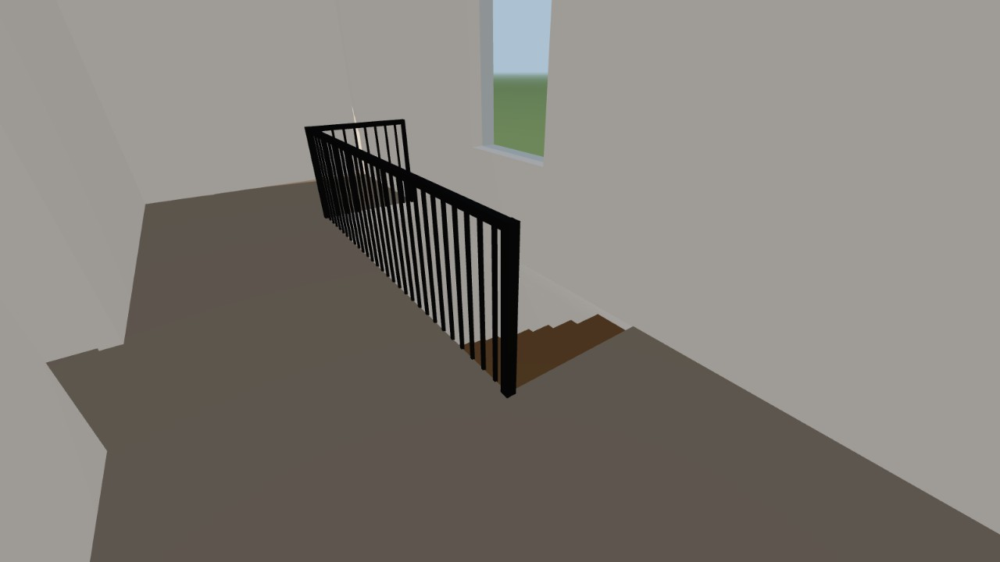 |
| **Third person** climbing the stairs | **First person** on the landing, looking down the stairwell |
| 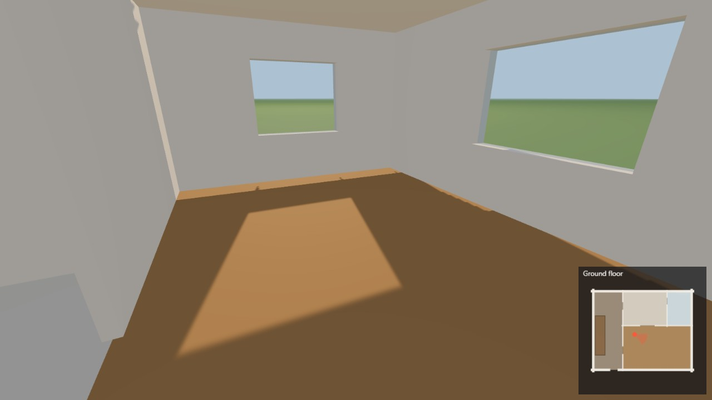 | 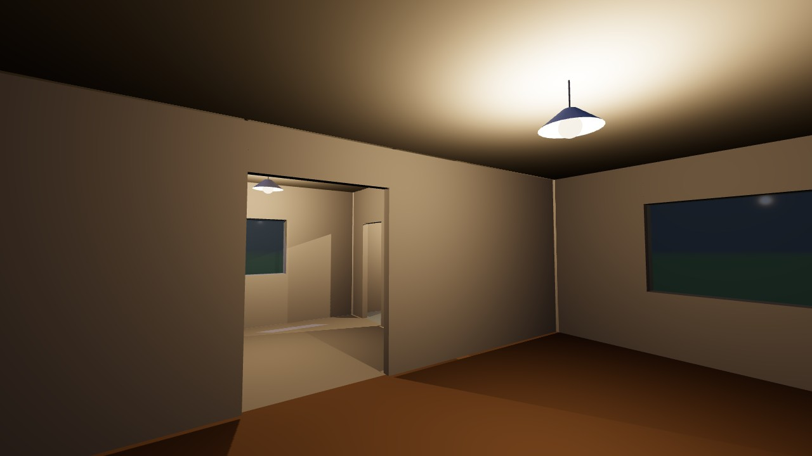 |
| **Day (8 AM)**: low morning sun through the east window lays a long patch across the living-room floor | **Night**: ceiling lamps light the room and cast light through the archway |

<p align="center">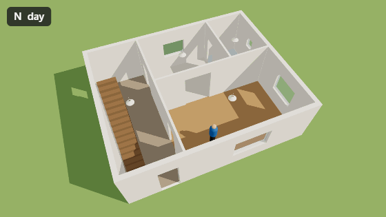</p>

| Day (8 AM) | Night |
|---|---|
|  | 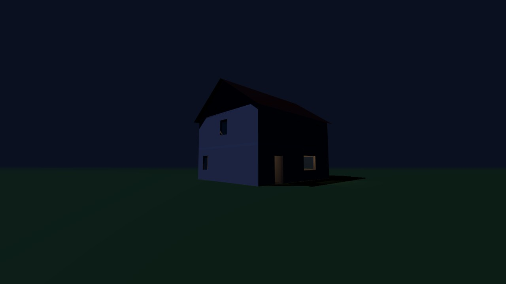 |
|  | 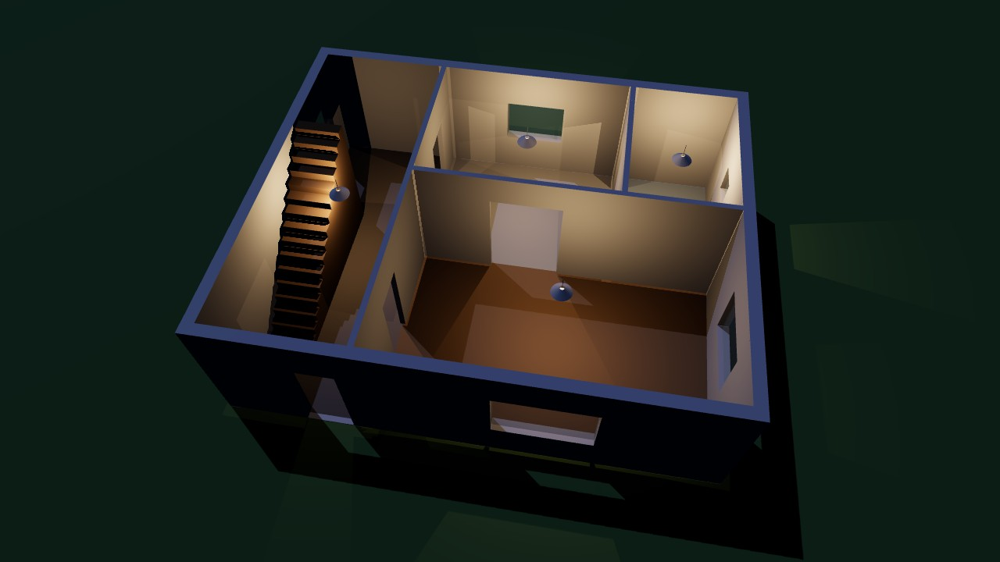 |

---

## How it works

```
 Plan files ──► Parser ──► House JSON ──► 2D editor ──► 3D builder ──► Walkthrough viewer
 (image/PDF/     (vision     (single        (fix & align   (Three.js      (1st/3rd person,
  DXF/SVG)        model)     source of      floors)        meshes)        physics, lighting)
                             truth)
   └──────── planned ───────┘                └ planned ┘   └──────────── built ────────────┘
```

1. **Validate** ([`validate.ts`](src/schema/validate.ts)): checks ids, that openings fit their walls, that rooms are closed shapes, that floors are in order, and that every stair has a hole in the floor above.
2. **Resolve** ([`resolve.ts`](src/schema/resolve.ts)): fills in defaults and applies each floor's `origin` offset, so all floors share one coordinate system.
3. **Build** ([`build.ts`](src/builder/build.ts)): turns the plan into 3D meshes.
   - Walls are cut around their openings, with a lintel above doors and windows and a sill below windows.
   - Floor slabs get holes for stairwells. Room floors are coloured by room type.
   - Stairs are built step by step, with a railing around the stairwell and a roof on top.
   - Meshes are merged by material so the scene draws quickly.
4. **Walk** ([`physics.ts`](src/viewer/physics.ts), [`walker.ts`](src/viewer/walker.ts)):
   - The player is a circle moving on the 2D plan. It collides with walls (with gaps at doors) and with railings.
   - The height under your feet comes from whichever is highest within a step's reach: the ground, a floor slab that has no hole at that spot, or the stair under you.
5. **Light** ([`lighting.ts`](src/viewer/lighting.ts)):
   - **Day, the 8 AM sun:** a `PointLight` with no distance falloff, placed 40 m out at compass bearing 105° (east-south-east) and 20° above the horizon. A glowing disc marks where it is in the sky. It casts soft shadows that fan out slightly from the sun. The position is set by `MORNING_SUN` in `lighting.ts`; change the bearing or elevation to set a different time of day.
   - **Night:** a dim directional moon. Both day and night add soft sky light.
   - At night, every room gets a ceiling lamp that casts its own shadows. Only the lamps on your current floor are switched on, which keeps it fast and stops light shining through the floor between storeys.

---

## The House JSON

One file describes the whole house ([`src/data/sample-house.json`](src/data/sample-house.json)). The types live in
[`src/schema/house.ts`](src/schema/house.ts) (**schema version 1**).

```jsonc
{
  "schemaVersion": 1,
  "house": { "name": "Sample two-storey house", "units": "m", "defaultFloorHeight": 3.0 },
  "floors": [
    {
      "id": "ground", "name": "Ground floor", "elevation": 0, "height": 3.0,
      "walls":    [{ "id": "g-s", "a": [0, 0], "b": [10, 0], "thickness": 0.25 }],
      "openings": [{ "id": "g-front-door", "wallId": "g-s", "type": "door",
                     "offset": 2.1, "width": 1.0, "height": 2.1, "sill": 0 }],
      "rooms":    [{ "id": "g-r-hall", "name": "Hall", "type": "hall",
                     "polygon": [[0, 0], [3, 0], [3, 8], [0, 8]] }],
      "voids":    [],
      "stairs":   [{ "id": "g-stair", "start": [0.7, 1.5], "direction": 90, "width": 1.0,
                     "steps": 16, "going": 0.25, "toFloor": "first" }],
      "rails":    []
    },
    {
      "id": "first", "name": "First floor", "elevation": 3.0, "height": 2.7,
      "voids": [{ "id": "f-stairwell", "polygon": [[0.125, 2], [1.2, 2], [1.2, 5.5], [0.125, 5.5]] }],
      "rails": [{ "id": "f-stair-rail", "points": [[0.125, 2], [1.2, 2], [1.2, 5.5]], "height": 1.0 }]
      // … walls, openings, rooms
    }
  ],
  "roof": { "type": "gable", "pitch": 35, "overhang": 0.4 }
}
```

### Conventions

| Topic | Rule |
|---|---|
| Units | Metres |
| Plan coordinates | `[x, y]`, x east, y north. All floors share one coordinate system. |
| Floor alignment | Optional `floor.origin: [dx, dy]` is added to every point on that floor |
| Angles | Degrees, counter-clockwise, `0` = east, `90` = north |
| `floor.elevation` | Height of the finished floor surface (top of the slab) |
| `floor.height` | Floor-to-floor height; walls default to it |
| `slabThickness` | Default `0.2` |
| Opening `offset` | Distance from `wall.a` to the opening's **centre**. `sill` is `0` for doors and arches |
| Stair `start` | Centre of the bottom edge of the first step. Rise per step = (upper elevation − lower elevation) / `steps`; flight length = `steps × going` |
| Stair ↔ void rule | The floor above must have a `void` over the flight wherever 2.0 m of headroom would hit the slab. Otherwise the validator reports an error |
| Roof | `gable` / `flat` / `none`. The outline comes from the top floor unless `roof.outline` is given |
| 3D mapping | Plan `[x, y]` → world `(x, height, −y)`, which keeps top-down views un-mirrored |

Changes to the schema are deliberate: bump `schemaVersion` and document them here.

---

## Project layout

```
src/
├── main.ts                 App wiring: scene, HUD, overview, render loop
├── style.css
├── data/
│   └── sample-house.json   Hand-written two-floor test house
├── schema/
│   ├── house.ts            House JSON types (schema v1)
│   ├── validate.ts         Plan checks (incl. stair ↔ void matching)
│   ├── resolve.ts          Defaults + floor origin offsets
│   ├── geometry.ts         Pure 2D helpers
│   └── house.test.ts       Validation + walking physics tests
├── builder/
│   ├── build.ts            House JSON → Three.js meshes
│   └── materials.ts        Room-type colours and materials
└── viewer/
    ├── physics.ts          Collision, stairs, gravity (no Three.js)
    ├── walker.ts           1st/3rd person controller + avatar
    ├── camera.ts           View maths (yaw, pitch, follow camera)
    ├── camera.test.ts
    ├── lighting.ts         8 AM point-light sun, moon, lamps, shadows, day/night
    ├── lighting.test.ts
    └── minimap.ts          2D minimap
docs/media/                 README screenshots and GIFs
```

---

## Testing

```bash
npm test
```

There are 15 tests. The logic they cover is pure TypeScript that doesn't need a browser:

- **Validation**: the sample house passes. Errors are reported for a missing stairwell void, a misaligned upper floor, an opening that runs past the end of its wall, and a reference to a missing wall.
- **Physics**: walls block you. You can walk in through the front door, climb the stairs to the first floor, and you can't walk into the side of the stair or past the railing into the stairwell.
- **Camera**: yaw and pitch directions, the face up/down limits, the third-person camera sitting behind the figure, and the camera moving in when something is in the way.
- **Sun**: the 8 AM sun is in the east-south-east, 20° above the horizon, and compass bearings map onto the correct world axes.

---

## Roadmap

1. ✅ **Hand-written two-floor House JSON, rendered and walkable**, with 1st/3rd person, minimap, overview, and day/night lighting
2. ⬜ **2D editor** to draw and correct plans, and to align floors on a shared reference point
3. ⬜ **Plan parsing**: a vision model converts images or PDFs of floor plans into House JSON. Results always go through the editor for manual correction.
4. ⬜ **Polish**: textures, furniture, better lighting, exterior and garden

---

## Known limitations

- Slab and roof outlines are the bounding box of the walls, which is right for rectangular houses but not for L-shaped plans.
- Only straight stair flights; no landings or winders yet.
- Flat colours, no door leaves, and a simple stand-in figure for third person.
- Pointer lock (mouse-look) needs a normal browser tab. In embedded previews, use the arrow keys to turn and to face up or down.
